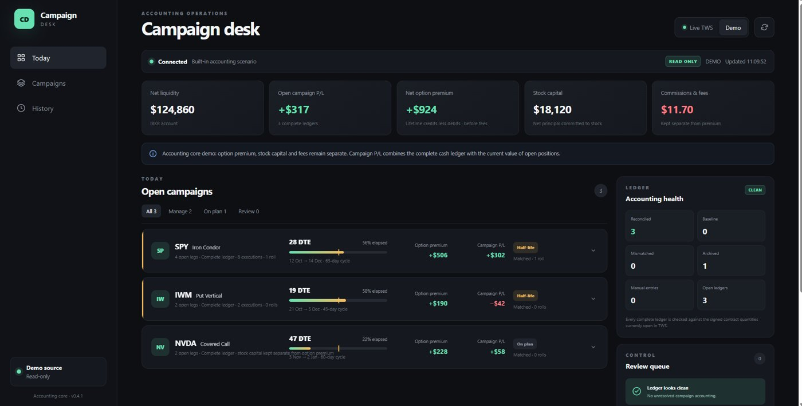
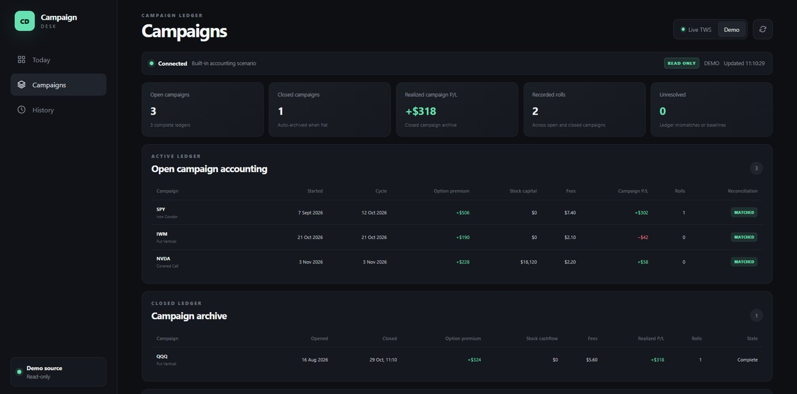
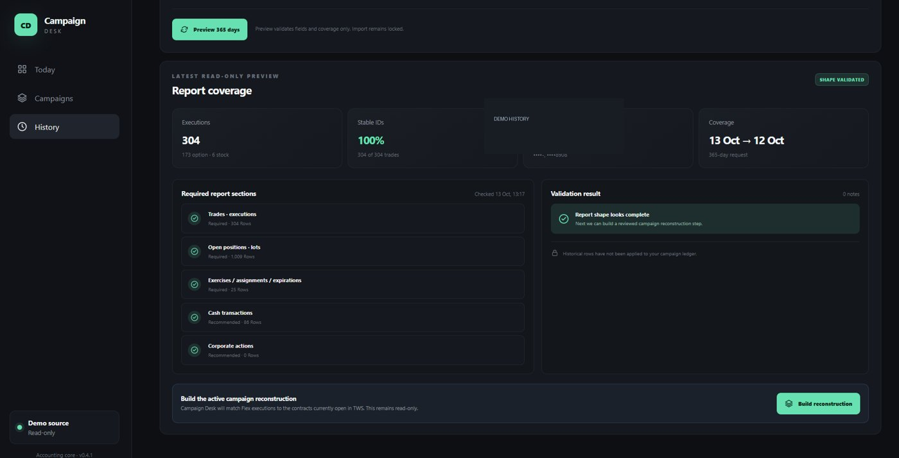

# Campaign Desk - IBKR Options Campaign Accounting

Local-first proof of concept for accounting across IBKR stock and options campaigns, including rolls, option premium, stock cashflows, commissions, lifecycle timing, reconciliation and historical Flex reconstruction.

## Application screenshots

The screenshots below show Campaign Desk's built-in **demo mode** with illustrative data. They are not actual brokerage balances, positions or performance results.

### Dashboard

*Demo dashboard — premium, stock capital, fees and campaign P/L are presented separately.*

### Campaign accounting

*Campaign ledger — open and closed campaigns, rolls, realised P/L and reconciliation status.*

### Historical report preview

*Read-only historical report preview — report coverage and validation before reconstruction.*

## Architecture

- .NET 10 local web application and accounting engine
- React / TypeScript frontend
- Python localhost, read-only TWS bridge
- Optional IBKR Flex history import with locally protected credentials
- No order placement endpoints; **not** a trading or execution system

## Run locally

See [README-FIRST-RUN.md](README-FIRST-RUN.md). Build using .NET 10, Node.js and Python 3.11+; the original Windows distribution included compiled runtime binaries which are intentionally excluded from this source repository.

## Privacy and sample data

The repository intentionally excludes user state, IBKR statements, credentials, Flex tokens, key material, local logs, binaries and packaged runtimes. Test accounts and contract IDs are placeholders; test positions and monetary figures are illustrative and are **not performance claims**.

Keep TWS on localhost with its API set to **read-only**. Do not expose the bridge or application endpoints to the public internet. Never commit the runtime `data/` directory, Flex XML, `.env` or broker exports.

## Status

Personal research and software proof of concept, not production financial software. Review source and local configuration before using it with any brokerage account.

## License

No open-source license is granted by this repository unless a LICENSE file is added. Third-party notices: [THIRD-PARTY-NOTICES.md](THIRD-PARTY-NOTICES.md).
